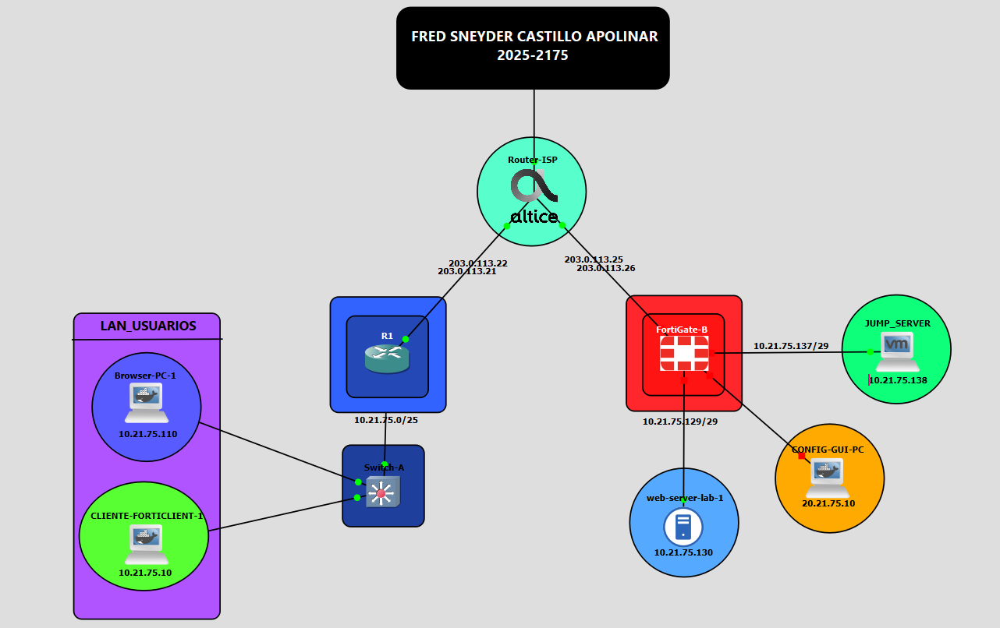
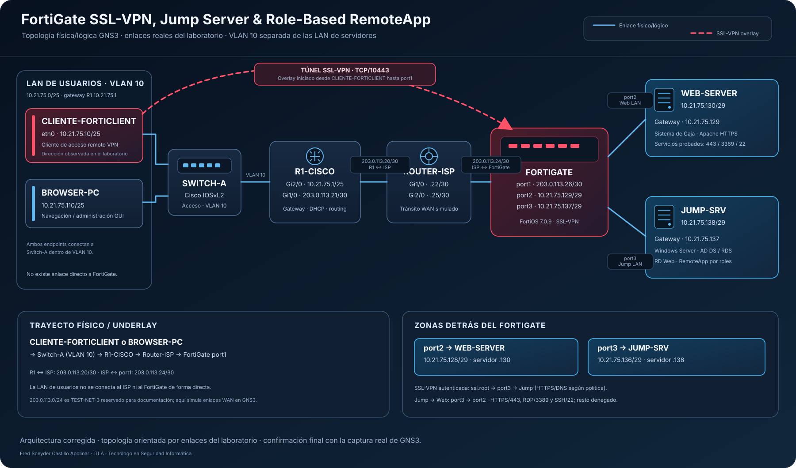
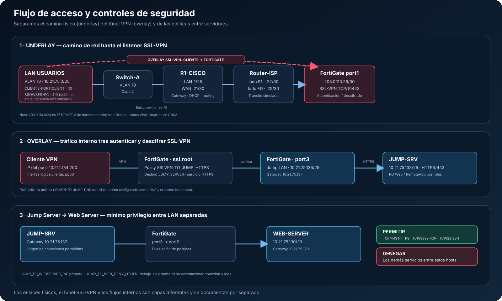
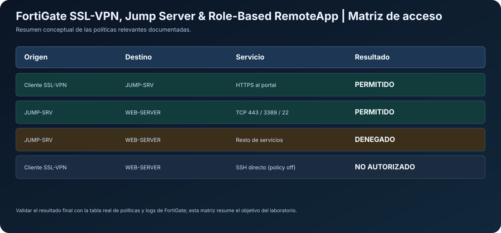

# FortiGate SSL-VPN, Jump Server & Role-Based RemoteApp

> **Laboratorio de Seguridad de Redes · GNS3 · FortiOS 7.0.9 · Cisco IOS · Windows Server RDS**

<p align="center">
  <a href="https://youtu.be/XtP_YsM0tjs">
    
  </a>
</p>

---

## 1. Objetivo del laboratorio

Este proyecto documenta una infraestructura de acceso remoto controlado. El cliente establece SSL-VPN con FortiGate, utiliza el Jump Server como punto de acceso administrado y obtiene un catálogo RemoteApp según su grupo. El tráfico iniciado desde Jump Server hacia el servidor web se restringe a HTTPS, RDP y SSH; una regla posterior deniega los demás servicios entre esos segmentos.

Diseñar, configurar y demostrar una topología en GNS3 que cumpla los requisitos de Seguridad de Redes:

- Administrar y demostrar la configuración de FortiGate mediante su **GUI**.
- Separar la LAN de usuarios, la LAN del Web Server y la LAN del Jump Server.
- Establecer una sesión de SSL-VPN Client-to-Site y dirigir el acceso remoto autorizado al Jump Server.
- Limitar Jump Server → Web Server a **TCP/443 (HTTPS), TCP/3389 (RDP) y TCP/22 (SSH)**.
- Publicar `Caja-Web` para el usuario estándar y `Caja-Web`, `PuTTY` y `Conexión a Escritorio remoto` para el usuario privilegiado.
- Conservar evidencia y procedimientos reproducibles para la topología, direccionamiento, políticas, VLAN/DHCP y servicios.

## 2. Arquitectura






La topología física/lógica exacta es: **CLIENTE-FORTICLIENT y BROWSER-PC → Switch-A (VLAN 10) → R1-CISCO → Router-ISP → FortiGate `port1`**. R1-CISCO es el gateway de la LAN de usuarios (`10.21.75.1/25`); Router-ISP aporta los dos enlaces WAN simulados entre R1 y FortiGate. No hay conexión directa de la LAN de usuarios al ISP ni a FortiGate. Del lado protegido, FortiGate `port2` conecta al WEB-SERVER (`10.21.75.130/29`) y `port3` conecta al JUMP-SRV (`10.21.75.138/29`). La curva discontinua del diagrama representa el overlay SSL-VPN sobre el trayecto físico, no un enlace físico directo.

## 3. Plan de direccionamiento

| Segmento | Red | IP conocida | Función |
|---|---|---|---|
| Usuarios / VLAN 10 | `10.21.75.0/25` | R1 `10.21.75.1`; cliente FortiClient `10.21.75.10`; Browser-PC `10.21.75.110` (estático en la instancia referenciada) | LAN de usuario, navegación y origen del cliente VPN. |
| R1 ↔ ISP | `203.0.113.20/30` | R1 `203.0.113.21`, ISP `203.0.113.22` | Tránsito WAN simulado. |
| ISP ↔ FortiGate | `203.0.113.24/30` | ISP `203.0.113.25`, FortiGate `port1` `203.0.113.26` | Enlace hacia el firewall y listener SSL-VPN en TCP/10443. |
| Web LAN | `10.21.75.128/29` | FortiGate `port2` `10.21.75.129`; WEB-SERVER `10.21.75.130` | Sistema web y destino de las pruebas. |
| Jump LAN | `10.21.75.136/29` | FortiGate `port3` `10.21.75.137`; JUMP-SRV `10.21.75.138` | RD Web, RDS/RemoteApp y salto administrado. |
| Pool SSL-VPN | `SSLVPN_TUNNEL_ADDR1` | `10.212.134.200–10.212.134.210`; `.200` observada en `ppp0` | Direcciones de sesión remota. |

**Nota de direccionamiento WAN:** `203.0.113.0/24` está reservado para documentación (TEST-NET-3). En este proyecto representa un ISP dentro de GNS3; no es una asignación pública real de Internet.

Cálculo de las LAN `/29`:

- Web: `10.21.75.128/29`; hosts utilizables `.129–.134`; broadcast `.135`.
- Jump: `10.21.75.136/29`; hosts utilizables `.137–.142`; broadcast `.143`.

El cálculo de subredes, direcciones y propósito de cada enlace se amplía en [03 — Plan de direccionamiento](docs/03-plan-direccionamiento.md).

## 4. Controles de seguridad relevantes



| Política | Flujo | Servicios | Estado documentado |
|---|---|---|---|
| `SSLVPN_TO_JUMP_HTTPS` | `ssl.root` → `port3` | HTTPS hacia `JUMP_SERVER` para `SSLVPN_USERS` | Habilitada. |
| `SSLVPN_TO_JUMP_DNS` | `ssl.root` → `port3` | DNS hacia el destino configurado | Habilitada. |
| `SLVPN_to_WEBSERVER_SSH` | `ssl.root` → `port2` | SSH directo al Web Server | Deshabilitada. |
| `JUMP_TO_WEBSERVER_P4` | `port3` → `port2` | HTTPS, RDP, SSH | Habilitada; NAT deshabilitado; logging de sesiones. |
| `JUMP_TO_WEB_DENY_OTHER` | `port3` → `port2` | ALL | Denegación posterior al permiso; `DENY` es la acción predeterminada en la salida `show` compartida. |
| `JUMP_SETUP_A_INTERNET` | `port3` → `port1` | DNS, HTTP, HTTPS | Salida auxiliar habilitada durante la preparación. |
| `WEBSERVER_A_INTERNET` | `port2` → `port1` | ALL | Política auxiliar de salida documentada; NAT habilitado. |
| `WAN_to_WEBSERVER_HTTPS` | `port1` → `port2` vía VIP | HTTPS al VIP | Deshabilitada desde la GUI; el objeto VIP se conserva. |

**Orden crítico:** `JUMP_TO_WEBSERVER_P4` debe aparecer por encima de `JUMP_TO_WEB_DENY_OTHER`. El permiso autoriza los tres servicios requeridos; la regla de cierre niega los demás servicios entre `JUMP_SERVER` y `WEBSERVER`.

Consulta [04 — FortiGate y políticas](docs/04-fortigate-y-politicas.md) para las interfaces, objetos, servicios, NAT, registros y ubicación de cada regla.

## 5. Jump Server, RDS y RemoteApp

JUMP-SRV ejecuta Windows Server 2019, dominio `jumpserver.lab` y colección RDS `QuickSessionCollection`. El portal Microsoft Remote Desktop Web Client se publicó en:

`https://JUMP-SRV.jumpserver.lab/RDWeb/webclient/index.html`

URL por IP utilizada desde el cliente:

`https://10.21.75.138/RDWeb/webclient/index.html`

### Catálogo de aplicaciones según el rol

| Usuario | Grupo(s) | Catálogo esperado/observado |
|---|---|---|
| `user.std` | `GG-RemoteApp-Web` | `Caja-Web` solamente. |
| `user.priv` | `GG-RemoteApp-Web` + `GG-RemoteApp-Privileged` | `Caja-Web`, `PuTTY`, `Conexión a Escritorio remoto`. |

La colección se consultó mediante `Get-RDRemoteApp`; las tres entradas tenían `ShowInWebAccess=True`. Los ejecutables configurados son Internet Explorer con URL del Web Server, PuTTY y `mstsc.exe`. Los grupos y comandos de auditoría se documentan en [06 — Jump Server y RemoteApp](docs/06-jump-rds-remoteapp.md).

## 6. Web Server

| Propiedad | Valor |
|---|---|
| Sistema | Ubuntu 22.04.5 LTS |
| Nodo lógico | `WEB-SERVER` / `web-server-lab` |
| IP/gateway | `10.21.75.130/29`, gateway `10.21.75.129` |
| Web root Apache | `/var/www/html` |
| Servicios comprobados | HTTPS/443, SSH/22, XRDP/3389 |

Comprobaciones locales útiles:

```bash
ip -br addr
ip route
service apache2 status
service ssh status || service sshd status
service xrdp status
ss -lntp | grep -E ':(22|443|3389)\b' || true
```

El nodo usa herramientas de servicio del contenedor; `systemctl` no es la interfaz operativa en este entorno si PID 1 no es systemd. Consulte [07 — Web Server](docs/07-web-server.md) y [11 — Operación y recuperación](docs/11-recuperacion-y-operacion.md).

## 7. Verificación de la conectividad

### Desde Jump Server hacia Web Server

Ejecutar en PowerShell en JUMP-SRV:

```powershell
Test-NetConnection 10.21.75.130 -Port 443
Test-NetConnection 10.21.75.130 -Port 3389
Test-NetConnection 10.21.75.130 -Port 22
```

Estas pruebas se realizaron repetidamente desde Jump. `TcpTestSucceeded=True` verifica conectividad TCP al puerto concreto desde ese origen; la política de FortiGate debe revisarse por separado.

### Desde el cliente VPN

Dentro de CLIENTE-FORTICLIENT, tras la conexión interactiva:

```bash
lab-vpn connect
```

Mantener esa terminal abierta mientras se utiliza el túnel. Desde otra terminal:

```bash
ip -br addr show ppp0
ip route get 10.21.75.138
ip route get 10.21.75.130
ip route show dev ppp0
```

La ruta hacia `10.21.75.138` se observó mediante `ppp0`; la ruta a `.130` se observó por la interfaz normal del cliente. La ruta indica el camino elegido por el kernel, no garantiza que una política permita el tráfico.

## 8. Scripts y operación

Los scripts están separados por plataforma y propósito:

- `scripts/linux/`: comprobación de estado y puertos del Web Server.
- `scripts/windows/`: verificaciones desde Jump y recopilación de evidencia RDS.
- `scripts/cliente/`: comprobación de rutas VPN y scripts de referencia de arranque gráfico.
- `scripts/maintenance/`: auditoría y recuperación específica de nodos de laboratorio.
- `scripts/fortigate/` y `scripts/cisco/`: instrucciones para exportar configuración real.

Lee `scripts/README.md` antes de ejecutar. El script `maintenance/05-recuperar-webserver-p4-idempotente.sh` cambia la red de `eth0`; debe ejecutarse únicamente como root dentro del Web Server.

## 9. Estructura del repositorio

```text
.
├── README.md
├── README_EN.md
├── images/                     # carpeta raíz, máximo 10 capturas
├── docs/                       # documentación técnica y diagramas
│   └── diagrams/               # SVG editables (no son capturas de pantalla)
├── scripts/                    # verificaciones, mantenimiento y exportación
├── running-configs/             # capturas y exportaciones por dispositivo
├── LICENSE
```

### Las diez capturas planificadas

| # | Captura | Archivo | Tiempo sugerido |
|---:|---|---|---:|
| 1 | Topología GNS3 | `images/01-topologia-general.png` | 00:15 |
| 2 | Interfaces FortiGate | `images/02-fortigate-interfaces.png` | 00:30 |
| 3 | Estado VPN y rutas | `images/03-vpn-rutas-cliente.png` | 00:48 |
| 4 | Catálogo estándar | `images/04-remoteapp-estandar.png` | 01:15 |
| 5 | Catálogo privilegiado | `images/05-remoteapp-privilegiado.png` | 01:42 |
| 6 | Pruebas Jump → Web | `images/06-pruebas-jump-web.png` | 02:10 |
| 7 | Políticas FortiGate | `images/07-politicas-firewall.png` | 02:50 |
| 8 | VLAN 10 Cisco | `images/08-vlan-usuarios.png` | 03:50 |
| 9 | DHCP usuarios | `images/09-dhcp-usuarios.png` | 04:10 |
| 10 | Servicios Web Server | `images/10-servicios-webserver.png` | 04:55 |

Los diez archivos PNG incluidos en el paquete son marcadores visuales para indicar qué capturar; no se presentan como evidencia real. Los tres diagramas SVG se mantienen separados en `docs/diagrams/`.

## 10. Documentación técnica por tema

- [00 — Requisitos y trazabilidad](docs/00-requisitos-y-trazabilidad.md)
- [01 — Propósito, alcance y diseño](docs/01-proposito-y-alcance.md)
- [02 — Arquitectura y topología](docs/02-arquitectura-y-topologia.md)
- [03 — Plan de direccionamiento](docs/03-plan-direccionamiento.md)
- [04 — FortiGate, objetos y políticas](docs/04-fortigate-y-politicas.md)
- [05 — SSL-VPN, pool y rutas](docs/05-ssl-vpn-y-rutas.md)
- [06 — Jump Server, AD DS, RDS y RemoteApp](docs/06-jump-rds-remoteapp.md)
- [07 — Web Server](docs/07-web-server.md)
- [08 — Cisco, ISP, VLAN y DHCP](docs/08-cisco-isp-vlan-dhcp.md)
- [09 — Pruebas y resultados de referencia](docs/09-pruebas-y-resultados.md)
- [10 — Procedimiento de demostración](docs/10-procedimiento-de-demostracion.md)
- [11 — Operación y recuperación](docs/11-recuperacion-y-operacion.md)
- [12 — Running-configs y exportación segura](docs/12-running-configs.md)
- [13 — Imágenes y evidencias](docs/13-imagenes-y-evidencia.md)
- [14 — Entregables y publicación](docs/14-entregables-y-publicacion.md)
- [15 — Glosario](docs/15-glosario.md)
- [16 — Implementación por componentes](docs/16-implementacion-y-componentes.md)
- [17 — Modelo de seguridad y flujo de paquetes](docs/17-modelo-de-seguridad-y-flujos.md)
- [18 — RD Web Client y roles RDS](docs/18-rds-webclient-y-roles.md)
- [19 — Catálogo de comandos](docs/19-catalogo-de-comandos.md)
- [20 — Decisiones de diseño](docs/20-decisiones-de-diseno-y-control-de-cambios.md)
- [21 — Registro de implementación](docs/21-bitacora-de-implementacion.md)
- [22 — Flujo de paquetes y enrutamiento](docs/22-flujo-de-paquetes-y-enrutamiento.md)
- [23 — Configuración/inspección de FortiGate por GUI](docs/23-procedimiento-fortigate-gui.md)
- [24 — Cisco, ISP, VLAN 10 y DHCP en detalle](docs/24-cisco-isp-vlan-dhcp-detallado.md)
- [25 — Implementación de AD DS, DNS, RDS y RemoteApp](docs/25-implementacion-rds-ad-dns-remoteapp.md)
- [26 — Matriz completa de pruebas de aceptación](docs/26-matriz-completa-de-pruebas.md)
- [27 — Hitos de implementación](docs/27-implementacion-por-hitos.md)
- [28 — Entrega y publicación](docs/28-modelo-de-entrega-y-publicacion.md)
- [29 — Persistencia y arranque de clientes GNS3](docs/29-persistencia-y-arranque-de-clientes.md)
- [30 — Control de SSH y separación de roles](docs/30-control-de-ssh-y-separacion-de-roles.md)

## 11. Flujo de trabajo recomendado

El orden recomendado para reproducir o revisar el laboratorio es: (1) confirmar direccionamiento y topología en GNS3; (2) inspeccionar las interfaces de FortiGate en GUI; (3) verificar el split tunneling y la sesión SSL-VPN; (4) comprobar los catálogos RemoteApp por usuario; (5) probar desde Jump los tres servicios autorizados; (6) comprobar la regla de denegación para el resto de servicios; (7) recopilar evidencias desde Cisco/R1/ISP y Web Server; y (8) exportar y sanitizar las configuraciones finales. Los capítulos 22–28 detallan estos procedimientos por equipo y por flujo.

## 12. Trazabilidad de la asignación

La matriz de requisitos se encuentra en [00 — Requisitos y trazabilidad](docs/00-requisitos-y-trazabilidad.md). Los detalles de topología, políticas, SSL-VPN, RDS, servicios, pruebas, operación, running-configs y entregables se distribuyen en los documentos numerados dentro de `docs/`.

## 14. Datos académicos

- **Estudiante:** Fred Sneyder Castillo Apolinar
- **Matrícula:** 2025-2175
- **Programa:** Tecnólogo en Seguridad Informática
- **Institución:** ITLA

## Licencia y uso

Laboratorio académico. Utiliza los scripts solo en equipos/redes propios o donde tengas autorización. Consulta `LICENSE`.

---

## 👨‍💻 Autor

**Fred Castillo**  
*Estudiante de Tecnólogo en Seguridad Informática* 

[](https://www.linkedin.com/in/fredcastillo11/)
[](https://github.com/fredcastillo)

---
