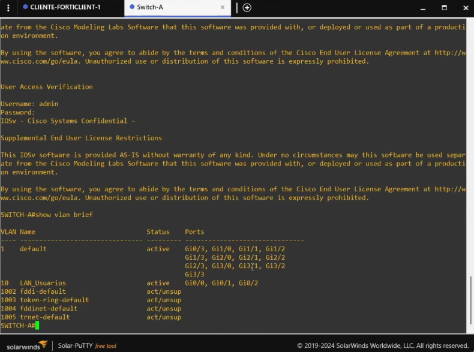
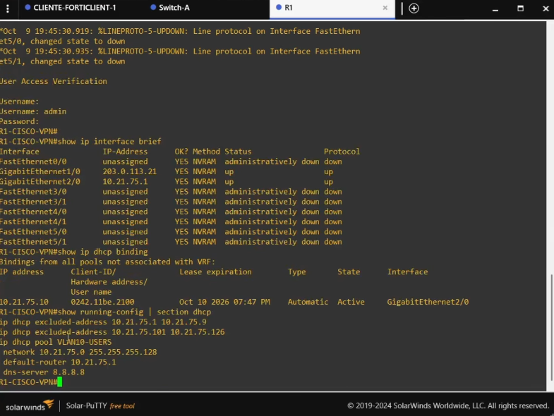

# 08. Cisco, ISP, VLAN 10 y DHCP

## Función del equipo de red

La cadena de conexiones es explícita: `CLIENTE-FORTICLIENT` y `BROWSER-PC` se conectan a `Switch-A` dentro de VLAN 10; `Switch-A` enlaza con la interfaz LAN de `R1-CISCO`; R1 tiene el enlace WAN hacia `Router-ISP`; y el Router-ISP tiene el segundo enlace WAN hacia FortiGate `port1`. Por tanto, el tráfico de la LAN de usuarios llega a FortiGate por `Switch-A → R1-CISCO → Router-ISP → port1`; no existe enlace directo LAN→ISP ni LAN→FortiGate. VLAN 10 separa el dominio de capa 2; R1 es el gateway `10.21.75.1/25` y proporciona DHCP para los endpoints. FortiGate no tiene una interfaz VLAN 10 en este diseño.

## VLAN 10

- Red de usuarios: `10.21.75.0/25`.
- Gateway en R1-CISCO: `10.21.75.1/25`.
- Cliente FortiClient observado: `10.21.75.10/25`.
- Browser-PC utilizado como navegador gráfico: `10.21.75.110/25` estático en la instancia referenciada; el DHCP actual debe verificarse para las cuentas/endpoints finales.
- El objetivo académico requiere los usuarios STD y PRIV en VLAN 10 y con direccionamiento DHCP. La evidencia debe identificar qué endpoint corresponde a cada usuario.

## Enlaces ISP simulados

| Enlace | Lado 1 | Lado 2 | Red |
|---|---|---|---|
| R1-CISCO ↔ Router-ISP | R1 `203.0.113.21/30` | ISP `203.0.113.22/30` | `203.0.113.20/30` |
| Router-ISP ↔ FortiGate | ISP `203.0.113.25/30` | FortiGate `port1` `203.0.113.26/30` | `203.0.113.24/30` |

El bloque `203.0.113.0/24` está reservado para documentación; dentro de GNS3 modela los enlaces WAN e ISP del ejercicio.

## Comandos de recopilación Cisco IOS

En modo EXEC privilegiado, ejecutar como consultas de solo lectura:

```text
show version
show ip interface brief
show vlan brief
show interfaces trunk
show ip dhcp binding
show ip dhcp pool
show ip route
show running-config
```

Para R1 se deben registrar la interfaz con `10.21.75.1/25`, los pools DHCP y las rutas. En el switch se deben registrar la VLAN 10, los puertos de acceso y el enlace hacia R1. Los running-configs finales deben proceder de los nodos P4 reales y revisarse antes de subirlos.

## Evidencia visual




